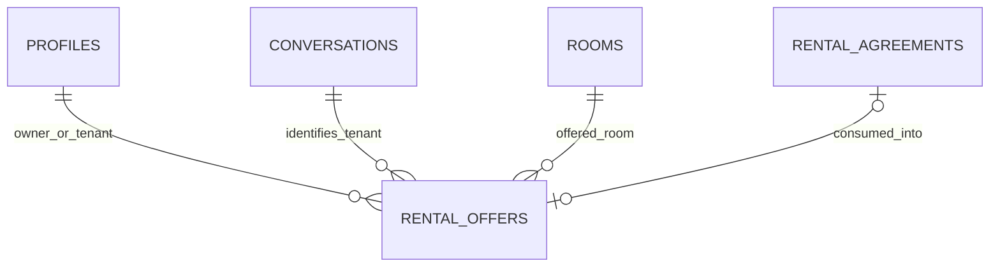

# API contracts

The applied migrations remain the source of truth. Phase 3 migration `20261119000200_backend_integration.sql` **has been applied to ngekosaja-development after explicit approval**. See [apply/postflight evidence](remote-apply-results.json). Existing migration files were not edited; the approved checksum remains unchanged.

## Additional RPCs

| Signature | Result | Authorization / atomic behavior |
| --- | --- | --- |
| `owner_save_property(payload jsonb)` | UUID | Owner only; create/update header, replace images/facilities/rules/landmarks in one transaction |
| `owner_save_room(payload jsonb)` | UUID | Own property; create/update room and facilities atomically; immutable property identity |
| `owner_propose_rental(payload jsonb)` | UUID | Own available room on published property; conversation must concern that exact property |
| `tenant_respond_rental(target_offer uuid, accept boolean)` | void | Named tenant only; pending, unexpired offer; owner cannot accept for tenant |
| `conversation_directory()` | up to 100 member rows | Counterparty display name, property context, preview and unread count; no global profile lookup |
| `operational_summary(platform_scope boolean=false, target_property uuid=null)` | JSON | Own owner scope or explicit admin platform scope; integer counts encoded as strings |

Property payload: optional `id`; `name`, `location`, `address`, `description`, integer-string `base_rent`, `gender_policy`, `room_size`, `publication_status`; arrays `images:[{path,alt}]`, `facilities:[uuid]`, `rules:[text]`, `landmarks:[{name,distance}]`. Only safe local `assets/images/` references are accepted; landmarks are labelled illustrative. Existing FK/check constraints remain authoritative. Any invalid child rolls back the header and all replaced children.

Room payload: optional `id`, `property_id`, `number`, `room_type`, integer-string `rent`, `operational_status`, `facilities:[uuid]`. Occupied is derived from active agreements and cannot be selected as an operational status.

Offer payload: `conversation_id`, `room_id`, `start_date`, `end_date`, integer-string `rent`, `payment_day`. Tenant identity is derived from the existing conversation, never from an email directory or caller-selected tenant UUID. Server stores property/room snapshots and a seven-day expiry. The tenant reviews terms before accepting or declining.

## Changed check-in contract

`owner_check_in(target_tenant uuid,target_room uuid,starts date,ends date,monthly_rent bigint,due_day smallint)` keeps its public signature but now requires an **accepted, unexpired offer matching all terms**. It locks and consumes that offer alongside the existing atomic check-in. The old implementation is moved to `private.check_in_consented`; browser and service-role direct EXECUTE are revoked. Existing constraints still prevent duplicate active tenant/room placement and historical overlap. Existing agreements are preserved.

This deliberate behavior change requires callers that previously used check-in after a conversation alone to adopt the offer workflow. The historical administrative account provisioning has already completed; do not rerun its apply path. Local fixture builders insert explicitly authorized fixtures in isolated databases and are separate from production onboarding.

Existing close/transfer, invoice/bulk/recurring, complaint transitions, conversation/message/read, reminder and analytics RPC signatures are retained. Transfer uses the existing scoped atomic transfer function and must follow the owner's documented agreement with the tenant; it does not currently store a separate transfer-consent offer.

## New relation

`rental_offers`: UUID PK; conversation, owner, tenant, room FKs; immutable-in-browser terms and property/room name snapshots; pending/accepted/declined/placed status; server expiry and response timestamps; optional unique agreement FK. RLS SELECT allows only either party or app admin. No authenticated INSERT/UPDATE/DELETE grant/policy. All writes use the RPCs. Five FKs are added; existing FK definitions remain unchanged.

Server-only `server_record_rent_payment`, `server_record_boost` and `server_grant_role` remain inaccessible to browser JWTs. No public success-payment or self-grant endpoint was added.
