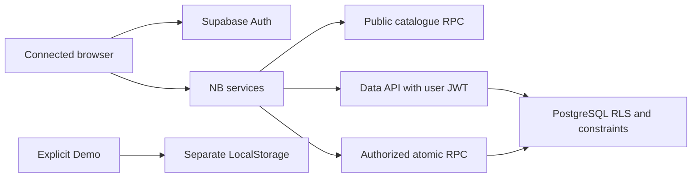

# Backend integration architecture

Phase 3 uses the existing buildless HTML/CSS/JavaScript application and Supabase SDK 2.99.3. No application server, framework, paid service, deployment or realtime subscription was added. Supabase remains the authentication and PostgreSQL boundary.

Connected routes use `window.NB`; demo routes continue using `window.NK` and their existing LocalStorage store. `window.NA` remains responsible for verified identity, profile and effective database roles. Backend routes never adopt a demo identity or read demo business state. Marketing composition is reused, while catalogue cards come from the public RPC; local dashboard previews and sample financial numbers are removed from the Connected homepage.

| Layer | Files | Responsibility |
| --- | --- | --- |
| Auth | `js/auth/` | Verified user, PKCE recovery, persistence, role guards |
| Core | `js/core/backend-core.js` | Lossless JSON, integer rupiah, safe assets, errors, cache, CSV |
| Services | `js/services/backend-services.js` | Domain services around Data API and RPC |
| Mappers | `js/adapters/data-mappers.js` | Database fields to view data, no demo conversion |
| Connected views | `js/backend/pages.js` | Route fetching, dashboards, public/personal pages |
| Forms | `js/backend/forms.js` | Database-backed forms, details and print documents |
| Events | `js/backend/events.js` | Async actions, validated submissions, analytics |
| Design extension | `css/backend.css` | Existing cards/sidebar/forms at responsive sizes |

Public catalogue pagination uses PostgREST range and filtering on the existing safe `public_listings()` result. Price ordering applies globally before pagination. Recommendations order active promotions first. No anonymous grant to private base tables was introduced.

Route requests are lazy, deduplicated, cached for 20 seconds and bounded to 60 entries per browser runtime. Facility master data is cached for five minutes. Cache keys include mode and verified UID; request generation and abort signals prevent late reads populating a different account. Private snapshots, dialogs and pending reads clear on identity disposal, logout and relevant rights changes. Writes invalidate route caches; no business cache is persisted locally.

See [integration guide](INTEGRATION_GUIDE.md) for the approved Cloud migration and [completion assessment](PHASE3_COMPLETION.md) for actual rollout/testing status. Cloud postflight is verified; multi-account business E2E is still a separate pending check.
