# Entity Relationship Diagram

Snapshot baseline 11 migrasi yang telah deployed. Final verification 19 November mencocokkan 31 tabel aplikasi dan 48 relasi/kardinalitas dengan katalog Cloud. Kandidat perbaikan belum menambah tabel/kolom/FK; lihat [FINAL_VERIFICATION.md](FINAL_VERIFICATION.md).

Dihasilkan dari PK/FK dan kolom database aktual. `auth_users` mewakili tabel Supabase Auth eksternal; hanya ID yang ditampilkan. Hubungan audit entity_id sengaja tidak mempunyai FK.

```mermaid
erDiagram
  auth_users {
    uuid id PK
  }
  activity_logs {
    uuid id PK
    uuid owner_id FK
    uuid actor_id FK
    text entity_table
    uuid entity_id
    text action
    text description
    timestamp_with_time_zone created_at
    timestamp_with_time_zone updated_at
  }
  boost_campaigns {
    uuid id PK
    uuid property_id FK
    uuid transaction_id FK, UK
    date start_date
    date end_date
    text source
    timestamp_with_time_zone created_at
    timestamp_with_time_zone updated_at
  }
  complaint_analyses {
    uuid id PK
    uuid complaint_id FK
    uuid accepted_by FK
    text rule_version
    text suggested_category
    text suggested_priority
    text summary
    text safe_action
    boolean emergency
    timestamp_with_time_zone created_at
    timestamp_with_time_zone updated_at
  }
  complaint_attachments {
    uuid id PK
    uuid complaint_id FK
    uuid uploaded_by FK
    text storage_path
    text mime_type
    integer size_bytes
    timestamp_with_time_zone created_at
    timestamp_with_time_zone updated_at
  }
  complaint_histories {
    uuid id PK
    uuid complaint_id FK
    uuid actor_id FK
    text previous_status
    text status
    text note
    timestamp_with_time_zone created_at
    timestamp_with_time_zone updated_at
  }
  complaint_notes {
    uuid id PK
    uuid complaint_id FK
    uuid author_id FK
    text body
    timestamp_with_time_zone created_at
    timestamp_with_time_zone updated_at
  }
  complaints {
    uuid id PK
    uuid agreement_id FK
    text title
    text description
    text category
    text urgency
    text priority
    text status
    date estimated_completion
    timestamp_with_time_zone confirmed_at
    timestamp_with_time_zone created_at
    timestamp_with_time_zone updated_at
  }
  conversation_members {
    uuid id PK
    uuid conversation_id FK
    uuid user_id FK
    timestamp_with_time_zone last_read_at
    timestamp_with_time_zone created_at
    timestamp_with_time_zone updated_at
  }
  conversations {
    uuid id PK
    uuid property_id FK
    uuid prospect_id FK
    timestamp_with_time_zone created_at
    timestamp_with_time_zone updated_at
  }
  facilities {
    uuid id PK
    text code UK
    text name UK
    timestamp_with_time_zone created_at
    timestamp_with_time_zone updated_at
  }
  favorites {
    uuid id PK
    uuid user_id FK
    uuid property_id FK
    timestamp_with_time_zone created_at
    timestamp_with_time_zone updated_at
  }
  invoices {
    uuid id PK
    uuid agreement_id FK
    date period_start
    date due_date
    bigint amount
    bigint admin_fee
    text status
    text notes
    text tenant_name_snapshot
    text property_name_snapshot
    text room_number_snapshot
    timestamp_with_time_zone created_at
    timestamp_with_time_zone updated_at
  }
  listing_analytics {
    uuid id PK
    uuid property_id FK
    uuid actor_id FK
    uuid session_id
    date event_date
    text kind
    timestamp_with_time_zone created_at
    timestamp_with_time_zone updated_at
  }
  message_attachments {
    uuid id PK
    uuid message_id FK
    text storage_path
    text mime_type
    integer size_bytes
    timestamp_with_time_zone created_at
    timestamp_with_time_zone updated_at
  }
  messages {
    uuid id PK
    uuid conversation_id FK
    uuid sender_id FK
    text body
    timestamp_with_time_zone created_at
    timestamp_with_time_zone updated_at
  }
  notifications {
    uuid id PK
    uuid user_id FK
    text dedupe_key
    uuid invoice_id FK
    text title
    text body
    text route
    timestamp_with_time_zone read_at
    timestamp_with_time_zone created_at
    timestamp_with_time_zone updated_at
  }
  profiles {
    uuid id PK, FK
    text display_name
    text phone
    timestamp_with_time_zone created_at
    timestamp_with_time_zone updated_at
  }
  properties {
    uuid id PK
    uuid owner_id FK
    text name
    text location
    text address
    text description
    bigint base_rent
    text gender_policy
    text room_size
    text publication_status
    timestamp_with_time_zone created_at
    timestamp_with_time_zone updated_at
  }
  property_facilities {
    uuid id PK
    uuid property_id FK
    uuid facility_id FK
    timestamp_with_time_zone created_at
    timestamp_with_time_zone updated_at
  }
  property_images {
    uuid id PK
    uuid property_id FK
    text image_path
    text alt_text
    integer position
    timestamp_with_time_zone created_at
    timestamp_with_time_zone updated_at
  }
  property_landmarks {
    uuid id PK
    uuid property_id FK
    text name
    text distance_label
    boolean is_illustrative
    timestamp_with_time_zone created_at
    timestamp_with_time_zone updated_at
  }
  property_rules {
    uuid id PK
    uuid property_id FK
    text rule_text
    integer position
    timestamp_with_time_zone created_at
    timestamp_with_time_zone updated_at
  }
  recent_searches {
    uuid id PK
    uuid user_id FK
    text query
    timestamp_with_time_zone created_at
    timestamp_with_time_zone updated_at
  }
  recurring_invoices {
    uuid id PK
    uuid agreement_id FK, UK
    bigint amount
    smallint payment_day
    date start_month
    date last_generated_month
    boolean active
    timestamp_with_time_zone created_at
    timestamp_with_time_zone updated_at
  }
  rental_agreements {
    uuid id PK
    uuid tenant_id FK
    uuid room_id FK
    date start_date
    date end_date
    bigint rent
    smallint payment_day
    text status
    date closed_on
    timestamp_with_time_zone created_at
    timestamp_with_time_zone updated_at
  }
  room_facilities {
    uuid id PK
    uuid room_id FK
    uuid facility_id FK
    timestamp_with_time_zone created_at
    timestamp_with_time_zone updated_at
  }
  rooms {
    uuid id PK
    uuid property_id FK
    text number
    text room_type
    bigint rent
    text operational_status
    timestamp_with_time_zone created_at
    timestamp_with_time_zone updated_at
  }
  tenants {
    uuid id PK, FK
    timestamp_with_time_zone created_at
    timestamp_with_time_zone updated_at
  }
  transactions {
    uuid id PK
    text kind
    uuid invoice_id FK
    uuid property_id FK
    bigint amount
    bigint admin_fee
    text method
    text status
    text idempotency_key UK
    boolean is_simulation
    timestamp_with_time_zone occurred_at
    timestamp_with_time_zone created_at
    timestamp_with_time_zone updated_at
  }
  user_roles {
    uuid id PK
    uuid user_id FK
    text role
    uuid granted_by FK
    timestamp_with_time_zone created_at
    timestamp_with_time_zone updated_at
  }
  user_settings {
    uuid id PK
    uuid user_id FK, UK
    boolean notifications_enabled
    boolean compact_mode
    boolean sidebar_collapsed
    timestamp_with_time_zone created_at
    timestamp_with_time_zone updated_at
  }
  auth_users ||--o| profiles : "id"
  profiles |o--o{ user_roles : "granted_by"
  profiles ||--o{ user_roles : "user_id"
  profiles ||--o| user_settings : "user_id"
  profiles ||--o{ properties : "owner_id"
  properties ||--o{ property_images : "property_id"
  properties ||--o{ property_rules : "property_id"
  properties ||--o{ property_landmarks : "property_id"
  facilities ||--o{ property_facilities : "facility_id"
  properties ||--o{ property_facilities : "property_id"
  properties ||--o{ rooms : "property_id"
  facilities ||--o{ room_facilities : "facility_id"
  rooms ||--o{ room_facilities : "room_id"
  profiles ||--o| tenants : "id"
  rooms ||--o{ rental_agreements : "room_id"
  tenants ||--o{ rental_agreements : "tenant_id"
  rental_agreements ||--o{ invoices : "agreement_id"
  rental_agreements ||--o| recurring_invoices : "agreement_id"
  invoices |o--o{ transactions : "invoice_id"
  properties |o--o{ transactions : "property_id"
  properties ||--o{ boost_campaigns : "property_id"
  transactions |o--o| boost_campaigns : "transaction_id"
  rental_agreements ||--o{ complaints : "agreement_id"
  profiles |o--o{ complaint_histories : "actor_id"
  complaints ||--o{ complaint_histories : "complaint_id"
  complaints ||--o{ complaint_attachments : "complaint_id"
  profiles ||--o{ complaint_attachments : "uploaded_by"
  profiles ||--o{ complaint_notes : "author_id"
  complaints ||--o{ complaint_notes : "complaint_id"
  profiles ||--o{ complaint_analyses : "accepted_by"
  complaints ||--o{ complaint_analyses : "complaint_id"
  properties ||--o{ conversations : "property_id"
  profiles ||--o{ conversations : "prospect_id"
  conversations ||--o{ conversation_members : "conversation_id"
  profiles ||--o{ conversation_members : "user_id"
  conversations ||--o{ messages : "conversation_id"
  conversation_members ||--o{ messages : "conversation_id_sender_id"
  profiles ||--o{ messages : "sender_id"
  messages ||--o{ message_attachments : "message_id"
  invoices |o--o{ notifications : "invoice_id"
  profiles ||--o{ notifications : "user_id"
  properties ||--o{ favorites : "property_id"
  profiles ||--o{ favorites : "user_id"
  profiles ||--o{ recent_searches : "user_id"
  profiles ||--o{ listing_analytics : "actor_id"
  properties ||--o{ listing_analytics : "property_id"
  profiles |o--o{ activity_logs : "actor_id"
  profiles |o--o{ activity_logs : "owner_id"
```

Kardinalitas `||` wajib satu, `|o` opsional satu, `o{` nol atau banyak. Child FK yang UNIQUE/PK menghasilkan relasi paling banyak satu. Constraint UNIQUE komposit dan exclusion interval lengkap ada di [Data Dictionary](DATA_DICTIONARY.md).
