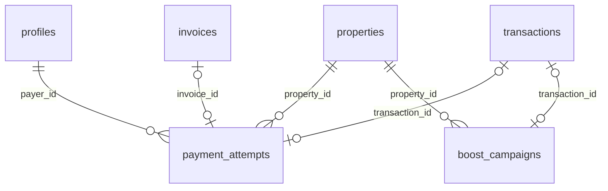

# Model data Internal Payment Simulator

Migration 20261120000100_internal_payment_simulator.sql sudah diterapkan ke ngekosaja-development pada 20 November 2026 setelah persetujuan. Pemeriksaan sebelum revisi memastikan versi ini belum applied sehingga file pending lama boleh direvisi/diganti namanya. Empat belas migration sebelumnya tetap utuh. File migration 15 sekarang historis/applied dan tidak boleh diedit. Tidak ada drop/alter destructive terhadap tabel existing.

| Entitas | Relasi / akses |
| --- | --- |
| public.payment_attempts | Payer → profiles; invoice → invoices; property → properties; transaction → transactions |
| private.payment_simulator_settings | Singleton development switch, default false; hanya pemilik DB |
| transactions / invoices / boost_campaigns | Tabel existing; ditulis melalui server_record_rent_payment/server_record_boost yang tetap server-only |

payment_attempts: id UUID PK; reference unik NKA-SIM-UUID; payer_id, invoice_id nullable, property_id; kind rent/boost; property_name_snapshot dan payer_name_snapshot; amount, admin_fee, gross_amount bigint rupiah; payment_method qris/virtual_account/bank_transfer/e_wallet; status pending/succeeded; is_simulation wajib true; environment wajib development; idempotency_key UUID unik; transaction_id unik; created_at, completed_at, updated_at timestamptz.

Constraints memeriksa jumlah total, fee sewa 2000, harga Boost 30000 tanpa invoice/fee, relasi, dan kelengkapan transaction_id/completed_at saat succeeded. Partial unique index mencegah dua sukses untuk satu invoice, melengkapi unique ledger existing. Index payer/property mendukung scope RLS/Realtimes. Guard history mencegah perubahan identitas dan riwayat final.

RLS SELECT attempt: payer, owner properti yang terkait, atau administrator. Tidak ada browser INSERT/UPDATE/DELETE. Settlement RPC hanya service_role dan tetap memeriksa development account/role/resource. Semua SECURITY DEFINER menetapkan search_path kosong dan tidak memberikan EXECUTE kepada PUBLIC. Settings berada dalam schema private, tanpa grant ke anon/authenticated/service_role; RPC definer membacanya secara terbatas.

Tiga tabel ditambahkan ke publication existing: payment_attempts, transactions, boost_campaigns. Publication hanya INSERT/UPDATE. Token Snap, gateway ID, payment_sessions dan payment_events tidak diperlukan; rancangan lamanya hanya tersimpan di arsip, tidak pernah diterapkan ke Cloud.

Katalog lokal dan postflight Cloud cocok: 35 tabel public, 62 FK, 49 policies, 40 public functions dan 13 publication members. Seluruh RLS aktif, indexes/constraints valid dan tidak ada unsafe definer. Enam akun fixture memiliki profil, role dan marker administratif yang sesuai berdasarkan pemeriksaan read-only. Lihat [aktivasi aktual](CLOUD_VERIFICATION.md); laporan revision-preflight/revision-remote-review tetap merupakan bukti historis sebelum apply.
