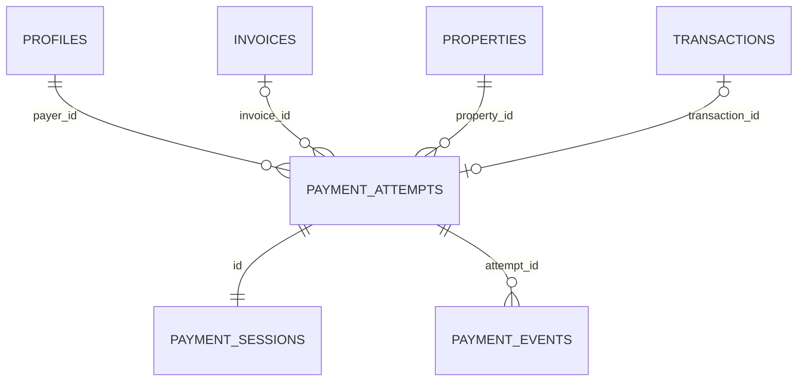

# Model data pembayaran

Migration 15 masih lokal. Hasil PostgreSQL sementara: 37 tabel publik, 64 FK, 49 policy, 44 fungsi publik, 13 publication members; tidak ada RLS disabled, invalid index, unsafe definer atau PUBLIC execute. Cloud masih baseline 14 migration; jangan menyamakan dua environment ini.

| Tabel/kolom | Kontrak |
| --- | --- |
| attempts.id/order_id | UUID internal dan unique NK-SB-UUID; identitas order tidak dapat dipilih browser |
| kind/invoice_id/property_id/payer_id | rent atau boost; invoice wajib untuk sewa, property/payer wajib; FK menjaga histori |
| property_name_snapshot/payer_name_snapshot | Nama untuk receipt historis, dibaca server saat reserve |
| amount/admin_fee/gross_amount | Integer rupiah, gross=amount+fee; rent fee=2000, boost amount=30000 dan fee=0 |
| environment | CHECK hanya sandbox |
| status | creating/pending/succeeded/denied/cancelled/expired/failed/review/refunded/partial_refund |
| gateway_transaction_id | Unique jika tersedia; dicocokkan dengan order sebelum apply |
| transaction_id | Unique FK ke ledger immutable; wajib untuk succeeded/refund states |
| payment_method/verified_at | Berasal dari status gateway yang diverifikasi server |
| expires_at/last_reconciled_at | Umur checkout dan throttle status; bukan pemicu settlement lokal |
| sessions.snap_token/lease_id/lease_until/create_count | Checkout credential privat, lease 90 detik, maksimal lima klaim; hanya server |
| events.event_key/gateway_status/outcome | SHA256 normalized status, unique attempt/key, append-only; tanpa raw payload/card data |

Partial unique index membatasi satu attempt creating/pending per invoice atau properti Boost. RPC memblokir resource yang membutuhkan review. Index lain mencakup payer, property, invoice, gateway ID, transaction FK dan event dedup. Pemrosesan reserve/apply memakai resource advisory lock lalu row lock yang konsisten; lease token menangani pembuatan Snap di luar transaksi database.

RLS SELECT attempt: payer, pemilik terkait atau administrator. Tidak ada authenticated write. Sessions/events tidak memiliki grant read/write browser dan tidak masuk publication. Reserve/claim/save/apply/reconcile hanya EXECUTE service_role dan tetap memakai private.require_server. Financial writers existing dipertahankan. payment_accounting memeriksa owner/admin dan scope property; capability RPC hanya versi/environment.

Tidak ada data historis dihapus, ledger diubah, Auth account/password diperbarui atau RLS lama dinonaktifkan. Freeze trigger baru melindungi nominal/cancellation invoice dan publication properti selama payment belum selesai. [Postflight SQL](../../supabase/review/phase5-postflight.sql) sudah disiapkan untuk verifikasi metadata setelah deployment yang disetujui; belum dijalankan pada Cloud karena tabel baru belum diterapkan.
