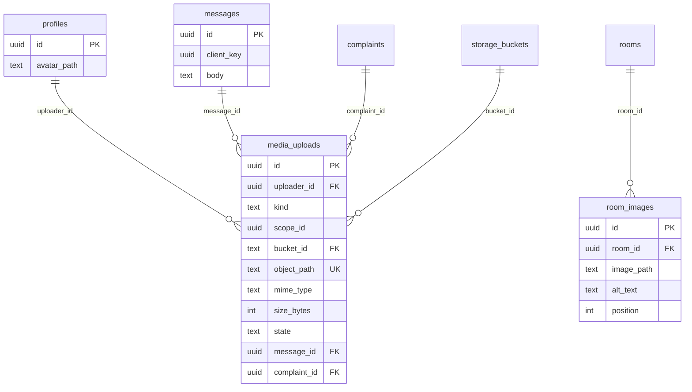

# Phase 4 schema, ERD and dictionary

Local and [approved Cloud postflight](../phase4/cloud-postflight-results.json) after migration 14 both confirm **34 public tables, 58 FKs, 48 public RLS policies, 37 public functions, 3 Storage policies; zero disabled RLS or unsafe definer paths**. The original preflight remains historical evidence of the 13-migration baseline. Schema deployment does not prove authenticated Storage/Realtime E2E.

| Change | Contract |
| --- | --- |
| profiles.avatar_path | Nullable typed reference, own RPC only; no change to direct name/phone grants |
| messages.client_key | Nullable UUID for legacy compatibility; partial unique sender/key index; append-only preserved |
| room_images.room_id/position | FK rooms, cascade only on safe room deletion; unique room/position, range 0–3, first is cover |
| media_uploads.uploader_id | FK profiles, derived auth.uid() |
| media_uploads.kind/scope_id | property/room/avatar/complaint/chat and validated resource ID |
| media_uploads.bucket_id/object_path | FK bucket; unique generated UUID path; no original filename |
| media_uploads.mime_type/size_bytes | Allowed images, positive ≤1 MB; avatar tighter in RPC/bucket |
| media_uploads.state | staged/finalized; finalized means committed at least once, not necessarily still referenced |
| media_uploads.message_id/complaint_id | Optional FK to immutable attachment parents; retry linkage |

Scope ID is polymorphic, not a universal FK. RPCs verify kind-specific property/room/profile/agreement/conversation relationships both at staging and finalization. No browser metadata writes are granted. Staging may remain after cancelled objects are removed, for audit. Indexes cover owner/age, scope, message/complaint FKs, gallery ordering and sender/request-key uniqueness.

New RPCs: begin_media_upload(text,uuid,text,integer), media_upload_status(uuid[]), set_my_avatar(text), send_message_media(uuid,text,uuid,uuid[]), tenant_create_complaint_media(uuid,text,text,text,text,uuid[]), phase4_capabilities(), conversation_avatars(uuid). Only capabilities is anonymous. Owner save RPC names/signatures are preserved; their old implementations move to private schema with browser/service execution revoked. Conversation directory keeps its signature and labels image-only previews “Lampiran foto”. Financial tables/views, role assignment, passwords and prior migrations stay unchanged.
